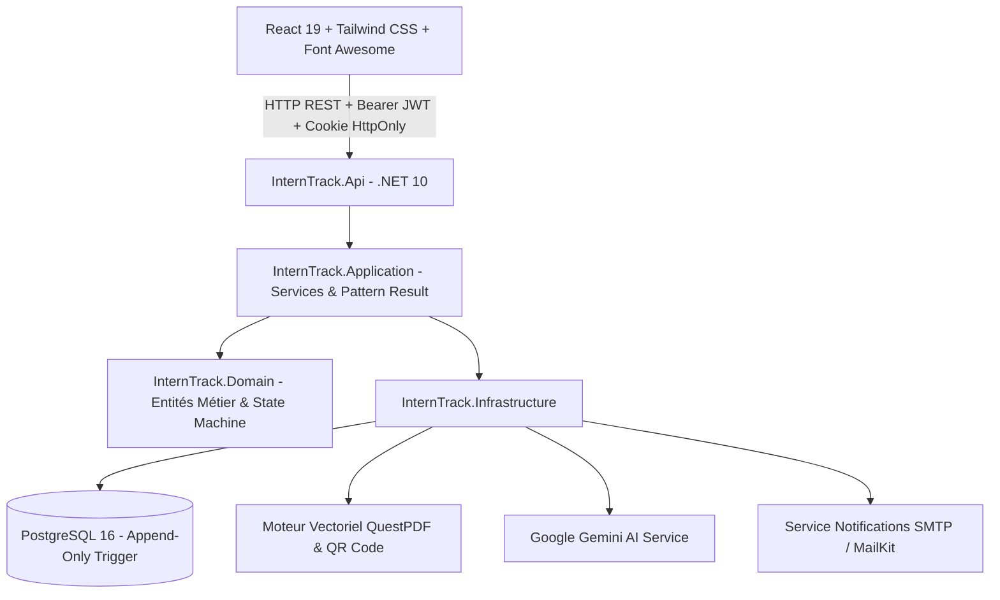

# 🎓 InternTrack — Plateforme Enterprise de Gestion des Stages & PFE

[](https://dotnet.microsoft.com/)
[](https://react.dev/)
[](https://www.typescriptlang.org/)
[](https://tailwindcss.com/)
[](https://fontawesome.com/)
[](https://www.postgresql.org/)
[](https://www.docker.com/)

**InternTrack** est une plateforme web d'entreprise moderne conçue pour digitaliser, piloter et certifier l'intégralité du cycle de vie des stages et **Projets de Fin d'Études (PFE)** des élèves ingénieurs au sein du réseau des **Écoles Nationales des Sciences Appliquées (ENSA)**.

Elle remplace les échanges dispersés par e-mails et les fichiers Excel par une solution unifiée, sécurisée et conforme aux exigences académiques.

---

## ⚡ Fonctionnalités Clés

- 📋 **Gestion du Cycle de Vie (Workflow State Machine)** : Machine à états finis stricte (`Brouillon` → `Proposé` → `Validé` → `En cours` → `Soutenance` → `Terminé`). Un dossier refusé (motif obligatoire) peut être retravaillé puis resoumis par l'élève. **Un seul dossier engagé par élève** (proposé, validé, en cours ou en soutenance). Les dates sont contrôlées : pas de début dans le passé, durée comprise entre 8 et 52 semaines (réglable), cohérente avec la durée de l'offre (±2 semaines).
- 📄 **Conventions PDF & vérification par QR Code** : générée à la validation du dossier, la convention est signée séparément par l'élève, l'école et l'entreprise. Celle-ci reçoit par e-mail un **lien de signature personnel** (usage unique, 14 jours) ; à défaut, l'école enregistre la signature papier sur **dépôt du scan signé**. le stage ne peut démarrer qu'une fois les trois signatures recueillies. Le PDF (QuestPDF) affiche l'état de chaque signature et un QR Code renvoie vers la page publique de vérification (`/verify-convention/:token`). Les signatures sont des attestations horodatées et tracées dans le journal d'audit, pas des signatures électroniques qualifiées.
- 🤖 **Suivi Hebdomadaire & Synthèse IA** : Dépôt des rapports d'avancement pendant le stage (semaine comprise dans la période et déjà commencée), modifiables tant qu'ils ne sont pas validés, échanges de commentaires entre l'encadrant et l'élève, validation pédagogique et résumé à la demande propulsé par **Google Gemini** (résumé de secours si aucune clé n'est configurée).
- 📅 **Planification des Soutenances & Anti-Collision** : jury composé à partir des comptes enseignants (un président obligatoire, 2 à 4 membres, tuteur entreprise externe possible), détection des conflits de salle et de double réservation d'un enseignant, **évaluation individuelle de chaque membre du jury**, note finale arrêtée par le président ou le responsable (moyenne proposée), correction motivée et tracée. Le **mémoire final** (PDF, 20 Mo maximum, contenu vérifié) est déposé par l'élève et consultable par l'encadrant et le jury.
- ✉️ **Notifications** : e-mails envoyés sur les événements de domaine (soumission, validation, refus, soutenance planifiée, nouveau rapport) et rappel 48 h avant chaque soutenance (élève et jury). Heures affichées dans le fuseau **Africa/Casablanca** (base IANA, suit les changements officiels).
- 🧭 **Pilotage** : rapport d'anomalies (dossiers engagés en double, stage démarré sans convention signée ou sans encadrant, soutenance manquante, comptes sans filière…) avec la correction à apporter, et **annulation administrative** motivée d'un dossier ; **année universitaire** (à partir du 1er septembre) et **promotion** de l'élève, bilan comparatif par année et **export Excel/CSV** du périmètre de chacun (protégé contre l'injection de formules).
- 🔏 **Intégrité de la convention** : à la dernière signature, l'exemplaire de référence est figé et son **empreinte SHA-256** est publiée sur la page de vérification. Chacun peut y vérifier un PDF reçu, calcul fait localement dans le navigateur : toute modification du fichier est détectée.
- 🧑‍💼 **Tuteur entreprise au jury** : il reçoit un lien d'évaluation personnel (note et appréciation), sans compte, jusqu'à l'arrêt de la note finale.
- 👤 **Gestion des comptes** : désactivation/réactivation, changement de mot de passe, mot de passe oublié (lien valable 2 h), déverrouillage ; gestion des offres (modification, désactivation) et des entreprises.
- 🛡️ **Journal d'Audit Réglementaire Immuable (Ledger)** : Traçabilité médico-légale inviolable garantie par un double verrouillage : Intercepteur EF Core + **Trigger PostgreSQL bloquant tout `UPDATE` ou `DELETE`**.
- 🔐 **Sécurité Avancée conforme OWASP** : Authentification hybride par double token (Access Token 15 min en mémoire volatile, Refresh Token tournant dans cookie `HttpOnly` avec hachage SHA-256 en base et détection de rejeu).
- 🎨 **UI/UX Moderne & Professionnelle** : Interface responsive conçue avec **Tailwind CSS**, composants **SAP UI5** et icônes vectorielles **Font Awesome** (zéro emoji, barres de recherche homogènes).

---

## 🚀 Démarrage Rapide avec Docker

### Prérequis
- [Docker Desktop](https://www.docker.com/products/docker-desktop/) installé et en cours d'exécution.

```bash
# 1. Cloner le dépôt
git clone https://github.com/achraf/InternTrack.git
cd InternTrack

# 2. Copier le fichier d'environnement
cp .env.example .env

# 3. Lancer la pile applicative (PostgreSQL + API .NET 10 + Client React 19)
docker compose up -d
```

### 🌐 Accès aux applications :
- **Application Web (Frontend)** : [http://localhost:3000](http://localhost:3000)
- **Documentation API (Swagger / OpenAPI)** : [http://localhost:5000/swagger](http://localhost:5000/swagger)

---

## 👥 Comptes de Démonstration (Pré-configurés)

Sur la page de connexion ([http://localhost:3000/login](http://localhost:3000/login)), des puces d'accès rapide permettent de se connecter en un clic :

| Profil | Identifiant (E-mail) | Mot de passe | Rôle & Permissions |
|---|---|---|---|
| 👑 **Administrateur** | `admin@ensa.ma` | `Admin@123456` | Utilisateurs (création, rôle, filière), entreprises, offres, registre d'audit immuable |
| 📋 **Responsable Filière (GI)** | `responsable.gi@ensa.ma` | `Resp@123456` | Validation / refus motivé, signatures école et entreprise, affectation des encadrants, démarrage, soutenances et notes, offres de sa filière |
| 👨‍🏫 **Encadrant Pédagogique** | `prof.tazi@ensa.ma` | `Prof@123456` | Suivi des élèves encadrés, commentaires et validation des rapports hebdomadaires, résumés IA |
| 🎓 **Élève Ingénieur (Actif)** | `etudiant.achraf@ensa.ma` | `Student@123456` | Stage en cours chez Capgemini (convention signée, rapports, dépôt du mémoire) |
| 🎓 **Élève Ingénieur (Candidat)** | `etudiant.fatima@ensa.ma` | `Student@123456` | Consultation des offres, proposition de stage en attente de validation |
| 🎓 **Élève Ingénieur (Soutenance)** | `etudiant.mehdi@ensa.ma` | `Student@123456` | Soutenance planifiée dans 5 jours |
| 🎓 **Élève Ingénieur (Validé)** | `etudiant.yassine@ensa.ma` | `Student@123456` | Stage validé chez OCP qui commence dans une semaine, signature entreprise attendue (lien à envoyer) |

---

## 🏗️ Architecture du Projet

Le backend applique les principes de la **Clean Architecture** (Architecture Onion) découplée de l'infrastructure et orientée cas d'utilisation :

```
├── src/
│   ├── InternTrack.Domain/          # Cœur métier : Entités, Enums, Règles du Workflow (zéro dépendance)
│   ├── InternTrack.Application/     # Cas d'utilisation, DTOs, Validation, Pattern Result
│   ├── InternTrack.Infrastructure/  # EF Core 10, PostgreSQL, QuestPDF, JWT, MailKit, Gemini IA
│   ├── InternTrack.Api/             # ASP.NET Core 10 Web API, Middlewares, Rate Limiter, Swagger UI
│   └── interntrack-client/          # React 19 + TypeScript + Vite + Tailwind CSS + Font Awesome
├── tests/
│   ├── InternTrack.Domain.UnitTests/       # Tests unitaires du domaine et de la machine à états
│   ├── InternTrack.Application.UnitTests/  # Tests unitaires des services applicatifs
│   └── InternTrack.Api.IntegrationTests/   # Tests d'intégration API (WebApplicationFactory)
└── docs/                                 # Diagrammes ER, Registre des décisions architecturales (ADR)
```

### Flux Applicatif



---

## 🧪 Tests & Qualité de Code

Tests automatisés avec **xUnit**, **FluentAssertions**, **Moq** et **Testcontainers** :

```bash
# Suite complète (Docker requis pour les tests PostgreSQL)
dotnet test InternTrack.sln

# Sans Docker : tout sauf les tests sur PostgreSQL réel
dotnet test InternTrack.sln --filter "Category!=PostgreSQL"
```

- **Domain Tests** : machine à états (soumission, validation, refus, réouverture), invariants des dates, signatures de convention, notation des soutenances.
- **Application Tests** : contrôle d'accès anti-IDOR par rôle et par filière, détection des conflits de soutenance et validation du jury, cycle refus → correction → resoumission, conventions (démarrage conditionné aux trois signatures), fenêtres de rappel des notifications, bornage de la pagination.
- **Integration Tests (base en mémoire)** : API complète via `WebApplicationFactory` : authentification, rotation et détection de rejeu du refresh token, autorisations, contrat JSON.
- **Integration Tests PostgreSQL** (`Category=PostgreSQL`) : un vrai PostgreSQL 16 démarré par Testcontainers vérifie ce que la base en mémoire ne peut pas tester :
  - migrations appliquées sans changement de modèle en attente ;
  - trigger append-only du journal d'audit ;
  - contrainte d'exclusion salle/créneau ;
  - concurrence optimiste (`xmin`) ;
  - index uniques et traduction SQL des recherches ;
  - planifications simultanées sérialisées ;
  - tolérance multi-onglets et rafraîchissements concurrents du refresh token ;
  - verrouillage de compte ;
  - réponses 400 sur données invalides et 409 sur décisions concurrentes.

```bash
# Vérification du typage et build du Frontend
cd src/interntrack-client
npm run build
```

---

## 💻 Développement Local (Sans Docker)

### Backend (.NET 10 API)
```bash
# Depuis la racine du projet
dotnet run --project src/InternTrack.Api
# L'API démarre sur http://localhost:5009 (ou https://localhost:7014)
```

### Frontend (React 19 + Vite)
```bash
cd src/interntrack-client
npm install
npm run dev
# L'interface démarre sur http://localhost:5173
```

---

## 🔐 Bonnes Pratiques & Sécurité

1. **Anti-XSS & Anti-CSRF** : Aucun jeton d'accès n'est stocké dans le `localStorage`. L'access token est volatile en mémoire React, tandis que le refresh token réside dans un cookie `HttpOnly; SameSite=Lax` (ou `SameSite=None; Secure` si front et API sont sur des domaines distincts, via `Auth:CrossSiteRefreshCookie`). Un changement de rôle révoque les sessions de l'utilisateur.
2. **Protection Anti-Brute Force** : 5 tentatives de connexion et 30 rafraîchissements par minute et par IP. En complément, **chaque compte est verrouillé 15 minutes après 5 échecs consécutifs** (réglable via `Security:MaxFailedLoginAttempts` / `Security:LockoutMinutes`), ce qui protège aussi contre une attaque répartie sur plusieurs IP ; l'administrateur peut déverrouiller un compte. Le message d'échec est identique dans tous les cas, ce qui empêche de deviner si un email existe. Derrière un reverse proxy, l'IP réelle n'est lue dans `X-Forwarded-For` que pour les proxys déclarés de confiance (`ReverseProxy:KnownNetworks` / `KnownProxies`).
   - **Plusieurs onglets** : les rafraîchissements sont sérialisés entre onglets (Web Locks API). Le serveur tolère en plus, pendant 30 s (`JwtSettings:RefreshTokenReuseGraceSeconds`), la réutilisation d'un refresh token tout juste remplacé tant que son remplaçant est actif. Au-delà, un rejeu révoque toutes les sessions.
3. **Contrôle d'accès au niveau ressource (Anti-IDOR)** : Chaque ressource (stage, rapport, soutenance, convention) vérifie les habilitations de l'utilisateur connecté, y compris le périmètre de filière des responsables.
4. **Vérification des conventions** : jeton aléatoire de 128 bits (générateur cryptographique) ; la page publique n'expose que les informations nécessaires à la vérification.
5. **Journal d'audit** : les champs sensibles (hash de mot de passe, security stamp, jetons) ne sont jamais recopiés dans le journal immuable.
6. **Robustesse** : pagination bornée (100 éléments maximum par page), énumérations JSON acceptées uniquement par leur nom.
7. **Validation des entrées** : chaque corps de requête est validé par FluentValidation avant d'atteindre la logique métier : champs obligatoires, formats (email, téléphone, URL), bornes numériques, et longueurs maximales partagées avec les colonnes de la base (`FieldLimits`). Une donnée invalide renvoie un **400** détaillé par champ, jamais un 500.
8. **Accès concurrents** :
   - *Concurrence optimiste* : toutes les entités métier portent la colonne système PostgreSQL `xmin` comme jeton de version. Si deux utilisateurs modifient la même ressource, le second reçoit un **409** au lieu d'écraser le premier.
   - *Planification des soutenances* : vérification des conflits et écriture s'exécutent sous un verrou PostgreSQL (`pg_advisory_xact_lock`), partagé par toutes les instances de l'API.
   - *Garantie au niveau base* : une contrainte d'exclusion (`btree_gist`) interdit physiquement deux soutenances qui se chevauchent dans la même salle.
   - Les violations d'unicité ou d'exclusion sont traduites en **409**.

---

## ☁️ Déploiement

Le déploiement Azure (App Service + Static Web Apps + PostgreSQL Flexible Server) est décrit dans [docs/AZURE_GUIDE.md](docs/AZURE_GUIDE.md). Le workflow [cd-azure.yml](.github/workflows/cd-azure.yml) se déclenche sur la branche `main`.

| Paramètre | Rôle |
|---|---|
| `JwtSettings__Secret` | Clé de signature JWT (32 caractères minimum, obligatoire) |
| `ConnectionStrings__DefaultConnection` | Chaîne de connexion PostgreSQL |
| `Cors__AllowedOrigins__0` | Origine du front autorisée |
| `AppConfig__FrontendBaseUrl` | URL du front, utilisée dans le QR Code des conventions |
| `Auth__CrossSiteRefreshCookie` | `true` si front et API sont sur des domaines différents |
| `ReverseProxy__KnownNetworks__0` | Réseau du reverse proxy de confiance (ex. nginx) |
| `Database__AutoMigrate` / `Database__SeedDemoData` | Migrations au démarrage / données de démonstration |
| `Smtp__Enabled`, `Smtp__Host`, … | Envoi réel des e-mails (sinon journalisés) |
| `Gemini__ApiKey`, `Gemini__Model` | Résumés IA des rapports |
| `VITE_API_BASE_URL` (build front) | URL de l'API quand elle n'est pas servie sous `/api` du même domaine |

---

## 📄 Licence

Ce projet est sous licence MIT — libre d'utilisation et d'adaptation.
Développé avec rigueur et passion pour l'excellence de l'enseignement supérieur d'ingénierie.
