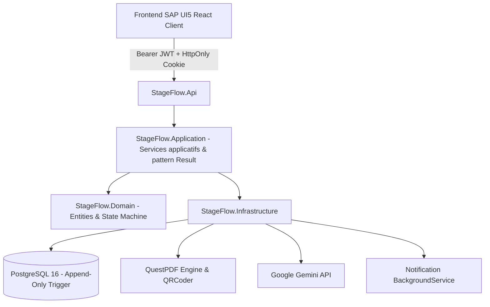

# StageFlow — Plateforme Enterprise de Gestion des Stages & PFE

[](https://github.com/achraf/StageFlow/actions/workflows/ci.yml)
[](https://dotnet.microsoft.com/)
[](https://reactjs.org/)
[](https://sap.github.io/ui5-webcomponents/)
[](https://www.postgresql.org/)

**StageFlow** est une application web d'entreprise moderne conçue pour digitaliser et automatiser l'intégralité du cycle de vie des stages et Projets de Fin d'Études (PFE) d'une grande école d'ingénieurs (ENSA). Elle élimine définitivement les échanges informels d'e-mails, les fichiers Excel non synchronisés et la gestion papier.

---

## 🚀 Démarrage Ultra-Rapide (3 commandes)

Prérequis : Docker & Docker Compose installés.

```bash
# 1. Cloner le dépôt
git clone https://github.com/achraf/StageFlow.git && cd StageFlow

# 1 bis. (Recommandé) Copier le modèle de variables d'environnement
cp .env.example .env

# 2. Démarrer l'ensemble de la pile applicative (PostgreSQL + API .NET + Client React UI5)
docker compose up -d

# 3. Ouvrir l'application dans votre navigateur
# Web App : http://localhost:3000
# Swagger API : http://localhost:5000/swagger
```

### Comptes de démonstration pré-configurés (Seed automatique) :
> **Note :** Sur la page de connexion ([http://localhost:3000/login](http://localhost:3000/login)), des puces interactives permettent de remplir instantanément ces identifiants en un seul clic !

| Rôle | E-mail | Mot de passe | Permissions clés |
| :--- | :--- | :--- | :--- |
| **Administrateur** | `admin@ensa.ma` | `Admin@123456` | Gestion des comptes (`/users`), journal d'audit immuable (`/audit`), vue globale |
| **Responsable Filière GI** | `responsable.gi@ensa.ma` | `Resp@123456` | Validation/Refus des dossiers de stage (`/internships`), démarrage des stages, planification soutenances (`/defenses`) |
| **Encadrant Pédagogique** | `prof.tazi@ensa.ma` | `Prof@123456` | Suivi hebdomadaire, feedbacks et commentaires pédagogiques, validation des rapports (`/reports`), résumé IA |
| **Élève Ingénieur (Achraf)** | `etudiant.achraf@ensa.ma` | `Student@123456` | Stage actif chez Capgemini, téléchargement Convention PDF avec QR Code, dépôt des rapports |
| **Élève Ingénieur (Fatima)** | `etudiant.fatima@ensa.ma` | `Student@123456` | Stage proposé chez CGI en attente de décision pédagogique |

### 🔐 Configuration & secrets

Le dépôt ne contient **aucun secret de production**. La configuration par défaut (`appsettings.json`) désactive les migrations automatiques, le seed de démonstration et l'envoi SMTP. En local, `appsettings.Development.json` active la clé JWT de développement, les migrations et le jeu de données de démonstration.

| Variable d'environnement | Rôle | Valeur par défaut (Compose) |
| :--- | :--- | :--- |
| `JWT_SECRET` | Clé de signature JWT (≥ 32 caractères obligatoires) | Secret de démonstration à remplacer |
| `POSTGRES_PASSWORD` | Mot de passe PostgreSQL | `stageflow_password` |
| `ASPNETCORE_ENVIRONMENT` | Environnement ASP.NET Core | `Development` |
| `SEED_DEMO_DATA` | Active le seeding de démonstration | `true` |
| `Database__AutoMigrate` | Applique les migrations au démarrage | `true` |
| `AppConfig__FrontendBaseUrl` | Base URL utilisée dans les QR codes de convention | `http://localhost:3000` |

> ⚠️ En production, définissez `ASPNETCORE_ENVIRONMENT=Production`, fournissez `JWT_SECRET` via un gestionnaire de secrets, passez `SEED_DEMO_DATA=false` et servez l'application derrière HTTPS.

### 💻 Développement local (hors Docker)

```bash
# API : http://localhost:5009 (profil http) — Swagger sur /swagger
dotnet run --project src/StageFlow.Api

# Client React : http://localhost:5173 (proxy Vite vers l'API)
cd src/stageflow-client && npm install && npm run dev
```

📖 **Documentation technique exhaustive & dossier d'architecture de A à Z :** voir [STAGEFLOW_DOCUMENTATION_COMPLETE.md](STAGEFLOW_DOCUMENTATION_COMPLETE.md).

---

## 🏛️ Architecture & Choix Techniques Senior

Le backend adopte une **Clean Architecture (Onion Architecture)** stricte garantissant l'indépendance de la logique métier vis-à-vis des frameworks et de l'infrastructure :

```
├── src/
│   ├── StageFlow.Domain/          # Cœur métier : Entités, Value Objects, Enums, Règles du Workflow
│   ├── StageFlow.Application/     # Cas d'utilisation (services applicatifs), DTOs, Pattern Result
│   ├── StageFlow.Infrastructure/  # EF Core, PostgreSQL, QuestPDF, JWT, Notifications SMTP, Gemini AI
│   ├── StageFlow.Api/             # ASP.NET Core Web API, Middlewares, Rate Limiting, OpenAPI Swagger
│   └── stageflow-client/          # React 19 + TypeScript + Vite + SAP UI5 Web Components
└── tests/
    ├── StageFlow.Domain.UnitTests/       # Règles du domaine et machine à états
    ├── StageFlow.Application.UnitTests/  # Services applicatifs et cas d'usage
    └── StageFlow.Api.IntegrationTests/   # API de bout en bout via WebApplicationFactory
```



### Principaux choix d'ingénierie :
1. **Machine à États Finis Stricte** : Workflow des stages (`Brouillon` → `Propose` → `Valide`/`Refuse` → `EnCours` → `SoutenancePlanifiee` → `Termine`). Toute transition illégale ou effectuée par un rôle non habilité (seul le Responsable de Filière peut valider ou refuser avec motif obligatoire) est rejetée au niveau du domaine métier.
2. **Journal d'Audit Immuable (Append-Only Ledger)** : Suivi médico-légal de chaque création, modification ou action sensible via un `AuditLedgerInterceptor` EF Core, combiné à un **trigger PostgreSQL** qui bloque formellement tout `UPDATE` ou `DELETE` sur la table `AuditLogs`.
3. **Convention PDF avec QR Code d'Authenticité Publique** : Génération vectorielle haute fidélité (QuestPDF) d'une convention officielle ENSA dotée d'un QR code infalsifiable. Ce QR renvoie vers `/verify-convention/{token}`, permettant aux entreprises d'authentifier instantanément la validité du document sans compte ni connexion.
4. **Détection Automatique de Conflits de Soutenances** : Algorithme vérifiant les chevauchements temporels de réservation de salle et la double-réservation des enseignants membres du jury.
5. **Authentification Hybride JWT Haute Sécurité** : Access Token courte durée conservé uniquement en mémoire JavaScript (immunisé contre les failles XSS) et Refresh Token tournant stocké dans un cookie `HttpOnly` (`SameSite=Lax`, `Secure` automatiquement activé en HTTPS), avec hachage SHA-256 en base et détection de réutilisation. Le endpoint de connexion est protégé par un rate limiter (5 tentatives/minute par IP).
6. **BackgroundService & Synthèse IA** : Tâche d'arrière-plan surveillant les échéances et déclenchant des notifications par e-mail, enrichie d'un service d'analyse IA (Google Gemini) derrière l'abstraction `IAiSummaryService`.
7. **Autorisation au niveau ressource (anti-IDOR)** : Chaque requête sur un stage, un rapport ou une soutenance est contrôlée par `IAccessControlService` selon le rôle réel de l'utilisateur (étudiant propriétaire, encadrant assigné, responsable de la filière ou administrateur). Les listes sont filtrées directement en SQL selon le périmètre autorisé.

---

## 🧪 Stratégie de Tests & Couverture

Pour exécuter la suite de tests xUnit :
```bash
dotnet test StageFlow.sln
```
- **Tests unitaires Domain & Application** : Validation exhaustive de la matrice des transitions d'états, invariantes temporelles de `DateRange`, et algorithme de collision de créneaux de soutenance.
- **Tests d'intégration API** : Utilisation de `WebApplicationFactory<Program>` exécutée en environnement `Development` avec une base EF Core InMemory et le jeu de données de démonstration. Les tests couvrent l'authentification, le cookie de refresh, les réponses `401`/`403` et les codes d'erreur HTTP `ProblemDetails`.

> **Note d'exécution** : les tests d'intégration partagent une base InMemory nommée et le rate limiter de connexion (5 requêtes/minute). Exécutez la suite complète avec `dotnet test StageFlow.sln` (sans `--no-build` après une modification).

---

## 📦 Limites Connues & Pistes d'Évolution

- **Dépôt de fichiers volumineux** : Les rapports de stage sont actuellement rédigés sous forme de texte enrichi avec synthèse IA. Une intégration Azure Blob Storage / AWS S3 permettrait l'upload direct de fichiers mémoires de 50 Mo.
- **Signature électronique avancée** : Intégration future d'une signature cryptographique X.509 ou DocuSign/Universign pour la signature tripartite dématérialisée (École, Entreprise, Étudiant).
- **WebSockets / SignalR** : Diffusion en temps réel des changements de statut et alertes instantanées dans la cloche de notification UI5.

---

## 💼 Présentation pour CV & Réseaux Professionnels

### 📌 Texte pour le CV (rubrique Projets / Réalisations) :
> **StageFlow — Plateforme Enterprise de Gestion des Stages & PFE (.NET 10, EF Core, React, SAP UI5, PostgreSQL, Docker)**  
> Conception et développement d'une application distribuée complète pour digitaliser le cycle de vie des stages d'une école d'ingénieurs (ENSA).  
> • Implémentation d'une Clean Architecture stricte (services applicatifs découplés, pattern `Result`), machine à états finis pour les workflows de validation et détection de conflits d'agendas pour les soutenances.  
> • Sécurisation avancée : Authentification JWT en mémoire avec rotation de refresh token dans cookie HttpOnly, RBAC, ledger d'audit append-only verrouillé par trigger SQL.  
> • Génération de conventions PDF vectorielles (QuestPDF) avec QR code d'authentification publique et service IA (Gemini) de résumé des rapports hebdomadaires.  
> • Suite de tests xUnit (unitaires et intégration avec WebApplicationFactory) et automatisation DevOps (Docker multi-stage, GitHub Actions CI/CD vers Azure).

---

### 🚀 Post LinkedIn prêt à publier :
```markdown
🚀 Fier de vous présenter mon dernier projet d'ingénierie logicielle : **StageFlow**, une plateforme d'entreprise conçue pour moderniser et automatiser la gestion des stages et PFE à l'ENSA !

Fini les chaînes d'e-mails interminables et les fichiers Excel perdus : StageFlow centralise tout le workflow académique au sein d'une expérience unifiée et rigoureusement encadrée.

🛠️ **Au cœur de la stack technique :**
🔹 **Backend** : C# / ASP.NET Core (.NET 10), Clean Architecture, pattern `Result`, EF Core 9 & PostgreSQL 16.
🔹 **Sécurité & Traçabilité** : JWT en mémoire + Refresh Token en cookie HttpOnly anti-XSS/CSRF, politiques d'autorisation fines (RBAC) et Journal d'Audit immuable (table append-only verrouillée par trigger SQL).
🔹 **Moteur Métier** : Workflow d'états strict, algorithme de détection de conflits de jury/salle pour les soutenances de PFE.
🔹 **Documents & Innovation** : Génération vectorielle de conventions PDF via QuestPDF intégrant un QR code de vérification publique en temps réel, complétée par un module de résumé intelligent des rapports via l'API Google Gemini.
🔹 **Frontend** : React 19, TypeScript, TanStack Query et l'élégance enterprise des composants SAP UI5 Web Components (@ui5/webcomponents-react).
🔹 **DevOps & Qualité** : Conteneurisation Docker multi-stage, suite de tests xUnit (unitaires & intégration WebApplicationFactory) et pipeline CI/CD GitHub Actions vers Azure.

Un grand pas dans la maîtrise de l'écosystème .NET moderne et des architectures logicielles d'entreprise !

🔗 Code source & documentation complète disponibles sur GitHub : [Lien vers votre dépôt]

#DotNet #CSharp #React #TypeScript #CleanArchitecture #Docker #SoftwareEngineering #PostgreSQL #Azure #OpenSource
```

---

## 🎯 10 Questions d'Entretien Technique & Réponses Détaillées

### 1. Pourquoi avoir choisi la Clean Architecture plutôt qu'une architecture en couches classique (N-Tiers) ?
> **Réponse** : Dans une architecture N-Tiers traditionnelle, la couche métier dépend souvent de l'accès aux données. Dans la Clean Architecture (Dependency Inversion Principle), le Domaine et l'Application sont au centre et ne dépendent d'aucune technologie externe. La base de données, la génération de PDF (QuestPDF) ou l'API Gemini ne sont que des détails d'infrastructure branchés via des interfaces (`IRepository`, `IConventionPdfGenerator`, `IAiSummaryService`). Cela rend le code hautement testable sans dépendance externe et pérenne face aux évolutions technologiques.

### 2. Comment avez-vous garanti l'intégrité du workflow des statuts de stage ?
> **Réponse** : Par l'encapsulation de la logique de transition au sein de l'entité `Internship` (Domain-Driven Design). Plutôt que de permettre la modification libre de la propriété `Status`, nous exposons des méthodes de domaine explicites (`Submit()`, `Approve()`, `Reject(reason)`, `Start()`). Chaque méthode vérifie l'état actuel et l'habilitation de l'acteur (par exemple, seul le Responsable de Filière peut approuver un stage au statut `Propose`). Toute transition illégale renvoie un `Result.Failure` explicite sans lancer d'exception inutile.

### 3. Pourquoi stocker l'Access Token en mémoire côté React et le Refresh Token dans un cookie HttpOnly ?
> **Réponse** : C'est la recommandation OWASP de référence. Stocker les tokens d'accès dans le `localStorage` expose l'application au vol de session en cas de vulnérabilité XSS (Cross-Site Scripting). En stockant l'access token en mémoire JavaScript (State React), aucun script tiers malveillant ne peut l'extraire du stockage persistant. Le Refresh Token, quant à lui, est encapsulé dans un cookie avec les flags `HttpOnly` (inaccessible au JS), `Secure` (activé automatiquement en HTTPS) et `SameSite=Lax` (protection CSRF tout en autorisant les appels cross-port en développement local), avec rotation automatique et détection de réutilisation.

### 4. Comment fonctionne votre journal d'audit immuable (Ledger) ?
> **Réponse** : Il combine deux niveaux de protection. Côté applicatif, un `AuditLedgerInterceptor` EF Core intercepte chaque appel à `SaveChangesAsync`, inspecte le `ChangeTracker` et génère automatiquement un enregistrement `AuditLog` contenant l'utilisateur, l'entité ciblée et le diff JSON. Côté base de données, une migration EF Core installe une fonction trigger PostgreSQL qui lève une exception `RESTRICT` si une requête `UPDATE` ou `DELETE` est exécutée sur la table `AuditLogs`. Même un utilisateur SQL ayant des droits d'écriture ne peut pas altérer l'historique.

### 5. Comment détectez-vous les conflits lors de la planification d'une soutenance ?
> **Réponse** : Dans `DefenseService`, nous exécutons une requête EF Core vérifiant deux critères au sein du créneau horaire sélectionné (durée de la soutenance) : premièrement, si la salle est déjà réservée par une autre soutenance ; deuxièmement, si l'un des membres du jury (professeurs) est déjà assigné à une autre soutenance active sur cette même plage. En cas de chevauchement, l'API renvoie un résultat structuré listant précisément les motifs de blocage sans bloquer le formulaire de l'utilisateur.

### 6. Pourquoi séparer les contrôleurs des services applicatifs plutôt que d'utiliser un bus de médiation ?
> **Réponse** : Les contrôleurs restent volontairement minces : ils valident l'entrée HTTP, délèguent au service applicatif spécialisé (`InternshipService`, `ProgressReportService`, `DefenseService`, etc.) puis traduisent le `Result` en réponse HTTP. Ce découpage respecte le principe de responsabilité unique (SRP) sans ajouter la complexité d'un bus de médiation : les cas d'usage sont explicitement injectés, testables unitairement et traçables. L'autorisation transverse est centralisée dans `IAccessControlService`, les erreurs prévisibles passent par `Result`, et le logging structuré est assuré par Serilog au niveau du pipeline ASP.NET Core.

### 7. Comment avez-vous évité les exceptions pour le contrôle de flux métier ?
> **Réponse** : L'utilisation d'exceptions pour des erreurs métier prévisibles (ex: transition de statut invalide, étudiant non trouvé) dégrade les performances (coût de capture de la stack trace) et rend le flux d'exécution opaque. Nous avons adopté le pattern `Result<T>` fonctionnel. Un cas d'usage retourne `Result.Success(data)` ou `Result.Failure("Message d'erreur")`. La couche API traduit ensuite ce résultat de manière déterministe en réponse HTTP 200 OK ou HTTP 400 Bad Request via `ProblemDetails`.

### 8. Quelle est la particularité du moteur de génération PDF QuestPDF ?
> **Réponse** : Contrairement aux solutions basées sur des navigateurs headless (Puppeteer / wkhtmltopdf) qui sont lentes, lourdes en mémoire et instables en conteneur, QuestPDF propose un moteur vectoriel C# natif haute performance basé sur SkiaSharp. Il offre une API déclarative fluide permettant de composer précisément la mise en page (en-tête académique, grilles, typographie officielle ENSA) et d'injecter directement l'image binaire du QR code généré à la volée.

### 9. Comment fonctionne l'authentification publique du QR code sans exposer de données sensibles ?
> **Réponse** : La convention générée contient un QR code dont l'URL pointe vers `/verify-convention/{token}`. Ce jeton cryptographique aléatoire unique (GUID cryptosécurisé) est stocké avec l'entité `Convention`. L'endpoint de vérification de l'API est public (`[AllowAnonymous]`) et renvoie un DTO non sensible contenant uniquement les métadonnées de validité (nom de l'élève, entreprise, dates du stage, filière et statut). Aucune note, commentaire confidentiel ou donnée personnelle superflue n'est divulguée.

### 10. Comment votre suite de tests xUnit valide-t-elle l'API de bout en bout ?
> **Réponse** : Nous utilisons `WebApplicationFactory<Program>`, qui démarre l'application ASP.NET Core en mémoire dans son cycle de vie réel avec son pipeline de middlewares (authentification JWT, rate limiting, gestionnaire d'erreurs global). Pour les tests d'intégration, nous configurons le `DbContext` sur une base isolée en mémoire via l'injection de dépendances personnalisée du builder de test. Nous pouvons ainsi envoyer des requêtes HTTP réelles via `HttpClient`, tester la sérialisation JSON et vérifier les en-têtes HTTP (cookies, tokens).
